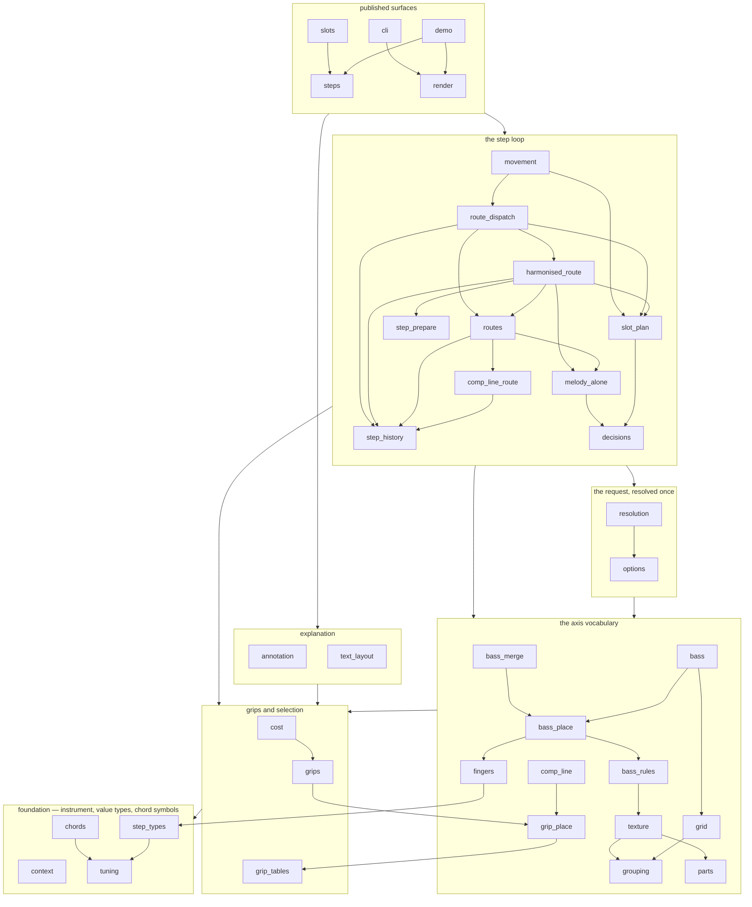
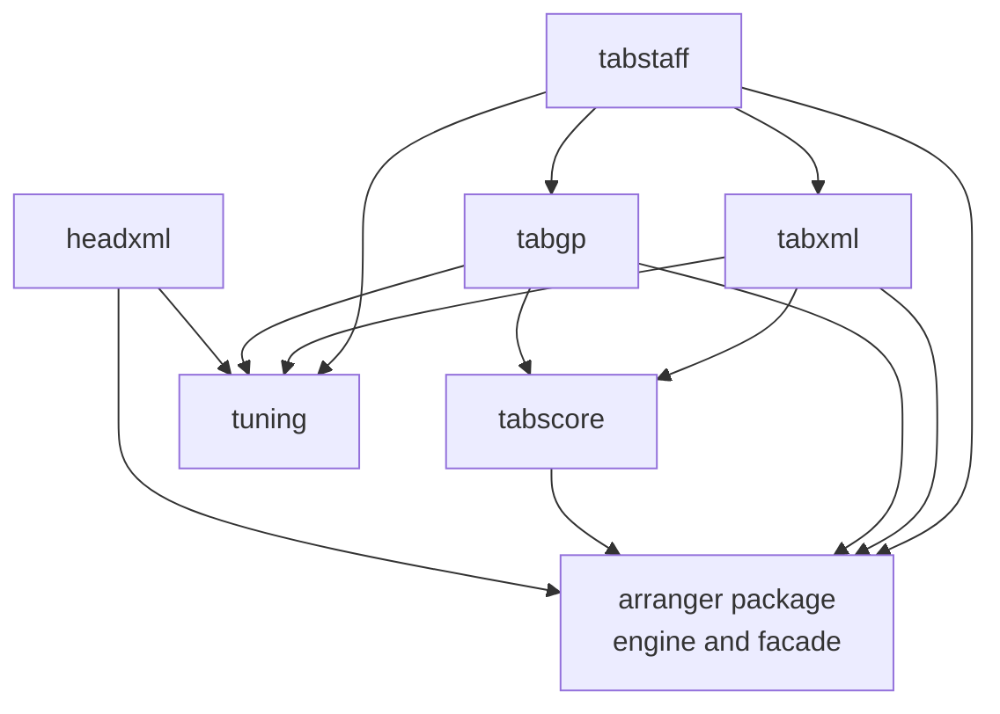

# Module dependency DAG

The tree has two enforced dependency graphs: the `arranger` package, and the
top-level modules beside it. This document draws their shape. It is a **reading**,
not a check: the source of truth is `ORDER` in `tests/meta_package_dag.py` and
`ALLOWED_FRONT_EDGES` in `tests/meta_front_end_dag.py`, and those tests fail when
the code stops matching them. Nothing compares this file with the tree.

An arrow means **"imports"**: `A --> B` is an import of `B` by `A`, whether it is
spelled `from .b import x` or `from . import b`. The diagrams are drawn
top-to-bottom, so a module sits above everything it imports and the foundation
(`tuning`, with `step_types` just above it) is at the bottom.

The engine diagram shows the **main** dependencies rather than every edge: the
boxes are the layers of the declared order, an arrow between two boxes is a direct
dependency between their modules (transitive ones are left out), and an arrow
inside a box is one of that layer's own main dependencies. The pinned tests read
the full edge set from each module's AST.

## The engine package

`__init__` is exempt from the order: it is the facade, so it sits above the whole
graph and imports every engine module. `__main__` imports the facade and nothing
else. Neither is drawn, because an edge from every module to the facade is not a
dependency any module may have — `test_no_module_imports_the_facade` is what
refuses it.

What the drawing makes visible:

- **The leaves import no sibling.** `tuning` is the instrument and `step_types` the
  value types (`Voicing`, `ArrangementStep`, `Palette`) with the tab-cell primitives;
  `context` is one slot's request; `parts` is the parts vocabulary. Because nothing
  is below them, every other module can depend on them without narrowing what may
  import it. `text_layout` is a fifth - a string and a column count, with no engine
  type in it - drawn in the explanation layer because that is the concern it serves.
- **The explanation layer is two halves.** `annotation` composes the words a step's
  explanation is made of, out of the step's own fields; `text_layout` decides where
  those words break. `render` is the only module that needs both, which is why the
  pair sits below it and beside one another.
- **`movement` is the loop, `route_dispatch` is the branch table, and
  `harmonised_route` is the route it usually takes.** `movement` owns the slot loop,
  the resolved knobs and the bass merge; `route_dispatch` holds the five entries that
  decide which route a planned slot goes to, in an order that is itself the contract -
  a fill or a comp that claims a slot and then declines it hands the slot on, so the
  tune never loses its chord to a thinner texture; `harmonised_route` is the
  melody-bearing branch - prepare the candidates, select one, demote to the tune
  alone, or emit a rest - and `step_prepare` is the shared "what can this slot
  sound" step beneath it. They reach the axes, the request and the grips; the
  surfaces' one way into the loop is still `movement`. A new axis is normally
  wired through `options` and `resolution` first, which is why both sit between
  it and the axes. `step_history` is the loop's memory of itself - what the hand was
  still holding when a slot arrived - and all four of `comp_line_route`, `routes`,
  `harmonised_route` and `route_dispatch` read it.
- **The surfaces do not feed back.** `steps`, `slots`, `render`, `cli` and `demo` sit
  at the top and import downwards; no layer below imports them. `demo` is the
  printing front end: it imports `steps` and `render`, and nothing imports it but
  the facade, which re-exports its `main`.

`ALLOWED_EDGES` is empty: every import points up the order, and an entry added to
it must carry a reason and fails the moment its import disappears.

## The top-level front ends

`FRONT_ENDS` in `tests/support.py` is the list this graph and the structure budget
both read. `tuning.py` is also a top-level module (added by this change) but is
not in `FRONT_ENDS`: it is a utility module imported by front ends, not a front end
itself. Every module-scope edge between front ends is recorded in
`ALLOWED_FRONT_EDGES` with its reason: `tabstaff` re-exports the two writers so
`from arranger import format_musicxml` has one spelling, and both writers import
`tabscore` for the score placement they share, which is what keeps `tabxml` and
`tabgp` independent of one another. `tabstaff`, `tabxml`, `tabgp`, `headxml`
all import `tuning` directly (top-level module) rather than
`arranger.tuning`, so none of them reaches into the `arranger` package at module
scope except through `arranger.step_types`. This graph is complete — it is small
enough to draw every recorded edge.

The rendering surface's lazy seams are **deliberately not drawn**, because they
are function-local rather than module-scope and so are not part of this DAG:

- `arranger.__getattr__` imports `tabstaff` on first access, so `import arranger`
  loads none of the six front ends;
- `demo.main()` imports `headxml` and the staff renderers inside the branch that
  needs them, so `import arranger` pulls in neither the importer nor the renderers
  it uses;
- `cli` imports `tabstaff` inside the function that dispatches the output, for the
  same reason.

### The import cycle, eliminated

The cycle that used to exist on paper -- `arranger.__getattr__` resolved `tabstaff`,
and `tabstaff` imported `arranger.tuning`, which ran `arranger/__init__.py` first --
is gone. `tuning` moved to a top-level module, so `tabstaff` imports `tuning`
directly and no longer reaches into the `arranger` package at module scope. With
`arranger/tuning.py` reduced to a re-export shim, nothing in a front end triggers
the package's `__init__`, and the two runtime measurements from
`tests/meta_front_end_dag.py::TestTheRuntimeCycle` still hold:

| question | measurement |
|---|---|
| does `import arranger` load a front end? | **no** - 0 of the six, which is the lazy seam working |
| can the four renderers import with the facade *absent*? | **yes** - with a blank `arranger` module in `sys.modules`, `tabstaff`, `tabxml` and `tabgp` all import and bind the same `ArrangementStep` |

`tabscore` and `headxml` are not in the blank-package test: `tabscore` has no
`arranger.tuning` edge, and `headxml` names the facade's public surface directly
(so it is imported by `demo.main()` after the facade is complete).

The `arranger/tuning.py` shim remains so that every `from .tuning import ...`
inside the package keeps working, and `arranger.tuning` still resolves as a
public path. The single source of truth is `tuning.py` at the top level.

The same lazy discipline holds for the optional extras: `tabxml` imports
`music21` and `tabgp` imports `PyGuitarPro` at the point of writing, so a caller
who wants neither can install neither.
: `tabxml` imports
`music21` and `tabgp` imports `PyGuitarPro` at the point of writing, so a caller
who wants neither can install neither.
