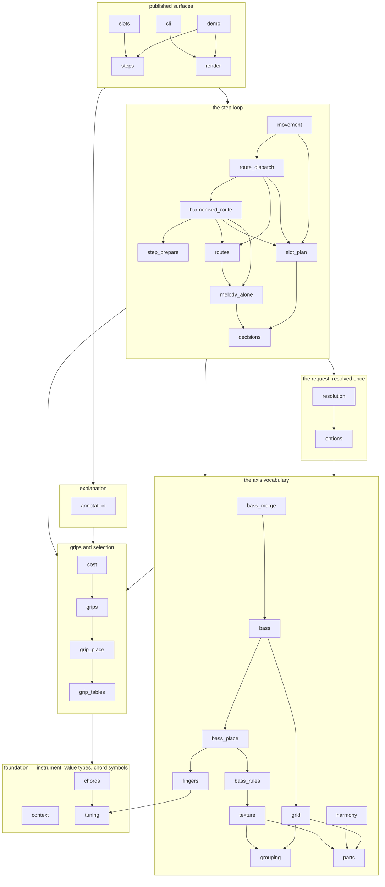
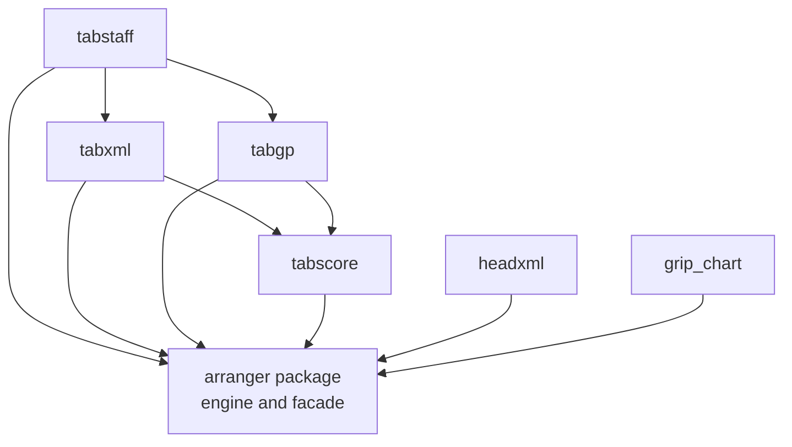

# Module dependency DAG

The tree has two enforced dependency graphs: the `arranger` package, and the
top-level modules beside it. This document draws their shape. It is a **reading**,
not a check: the source of truth is `ORDER` in `tests/test_package_dag.py` and
`ALLOWED_FRONT_EDGES` in `tests/test_front_end_dag.py`, and those tests fail when
the code stops matching them. Nothing compares this file with the tree.

An arrow means **"imports"**: `A --> B` is an import of `B` by `A`, whether it is
spelled `from .b import x` or `from . import b`. The diagrams are drawn
top-to-bottom, so a module sits above everything it imports and the foundation
(`tuning`) is at the bottom.

The engine diagram shows the **main** dependencies rather than every edge: the
boxes are the layers of the declared order, an arrow between two boxes is a direct
dependency between their modules (transitive ones are left out), and an arrow
inside a box is one of that layer's own main dependencies. The pinned tests read
the full edge set from each module's AST.

## The engine package

`__init__` is exempt from the order: it is the facade, so it sits above the whole
graph and imports every engine module. `__main__` imports the facade and nothing
else. Neither is drawn, because an edge from every module to the facade is not a
dependency any module may have — `test_no_module_imports_the_facade` is what
refuses it.

What the drawing makes visible:

- **The leaves import no sibling.** `tuning` is the instrument and the value types;
  `context` is one slot's request; `parts` is the parts vocabulary. Because nothing
  is below them, every other module can depend on them without narrowing what may
  import it.
- **`movement` is the loop, `route_dispatch` is the branch table, and
  `harmonised_route` is the route it usually takes.** `movement` owns the slot loop,
  the resolved knobs and the bass merge; `route_dispatch` holds the five entries that
  decide which route a planned slot goes to, in an order that is itself the contract -
  a fill or a comp that claims a slot and then declines it hands the slot on, so the
  tune never loses its chord to a thinner texture; `harmonised_route` is the
  melody-bearing branch - prepare the candidates, select one, demote to the tune
  alone, or emit a rest - and `step_prepare` is the shared "what can this slot
  sound" step beneath it. They reach the axes, the request and the grips; the
  surfaces' one way into the loop is still `movement`. A new axis is normally
  wired through `options` and `resolution` first, which is why both sit between
  it and the axes.
- **The surfaces do not feed back.** `steps`, `slots`, `render`, `cli` and `demo` sit
  at the top and import downwards; no layer below imports them. `demo` is the
  printing front end: it imports `steps` and `render`, and nothing imports it but
  the facade, which re-exports its `main`.

`ALLOWED_EDGES` is empty: every import points up the order, and an entry added to
it must carry a reason and fails the moment its import disappears.

## The top-level front ends

`FRONT_ENDS` in `tests/support.py` is the list this graph and the structure budget
both read. Every module-scope edge between front ends is recorded in
`ALLOWED_FRONT_EDGES` with its reason: `tabstaff` re-exports the two writers so
`from arranger import format_musicxml` has one spelling, and both writers import
`tabscore` for the score placement they share, which is what keeps `tabxml` and
`tabgp` independent of one another. This graph is complete — it is small enough to
draw every recorded edge.

The rendering surface's lazy seams are **deliberately not drawn**, because they
are function-local rather than module-scope and so are not part of this DAG:

- `arranger.__getattr__` imports `tabstaff` on first access, so `import arranger`
  loads none of the six front ends;
- `demo.main()` imports `headxml` and the staff renderers inside the branch that
  needs them, so `import arranger` pulls in neither the importer nor the renderers
  it uses;
- `cli` imports `tabstaff` inside the function that dispatches the output, for the
  same reason.

### The loop those seams make, and why it is inert

Drawn from both directions the graph has a loop: `arranger` resolves `tabstaff`
through `__getattr__`, and every rendering front end imports `arranger.tuning` -
which means importing a *submodule*, and importing a submodule runs the package's
`__init__` first. Measured on the tree rather than argued:

| question | measurement |
|---|---|
| does `import arranger` load a front end? | **no** - 0 of the six, which is the lazy seam working rather than an AST claim |
| can the four renderers import with the facade *absent*? | **yes** - with a blank `arranger` module in `sys.modules`, so `__getattr__` does not exist, `tabscore`, `tabstaff`, `tabxml` and `tabgp` all import and bind the *same* `ArrangementStep`; their reverse edge is the leaf |
| what would a module-scope `from tabstaff import ...` in the facade cost? | it **works**, and loads `tabstaff`, `tabxml`, `tabgp` and `tabscore` on every `import arranger`. Three-run wall times overlapped (0.7-1.5 s either way), so the cost is the modules and the write paths, not the seconds |
| what would a module-scope `import headxml` cost? | it **fails**: `ImportError: cannot import name 'CHORD_FILLS_COMP'` - `headxml` names the facade's public surface and meets a facade that has not defined it yet |

So the loop is a cycle on paper only, in the direction the code takes it: neither
side waits for the other, because the front ends need `tuning` and the facade's
edge is taken *after* the facade is complete. The one ordering that would break is
a front end imported **during** the facade's own initialisation, and `headxml`
above is that case made visible. `tests/test_front_end_dag.py::TestTheRuntimeCycle`
holds each row of the table.

**Eliminating the loop is not worth what it costs.** The only edge that could go is
the benign one: `tuning` would move to a top-level module, with `arranger/tuning.py`
left as a shim and a new public module added to `py-modules`, the Makefile's
`MODULES`, `typecheck` and `FRONT_ENDS`. That leaves `headxml`'s edge - the one
that actually fails - exactly where it is, so the price would be a new public name
and a second source for "where the voicing dataclasses live", to redraw a diagram.

The same lazy discipline holds for the optional extras: `tabxml` imports
`music21` and `tabgp` imports `PyGuitarPro` at the point of writing, so a caller
who wants neither can install neither.
